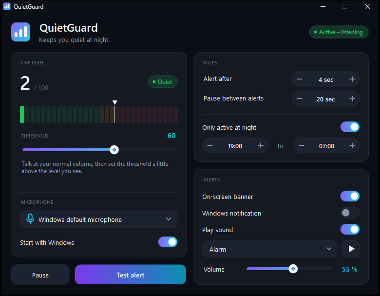

<p align="center">
  
</p>

<h1 align="center">QuietGuard</h1>

<p align="center">
  <b>Keeps you quiet at night.</b><br>
  A small Windows app that listens to your microphone and warns you the moment you get too loud.
</p>

<p align="center">
  <a href="../../releases/latest"></a>
</p>

<p align="center">
  
</p>

---

## Why?

Gaming, voice calls, heated discussions: at night it's easy to get much louder than you realize. QuietGuard keeps an eye on your microphone level. Stay above your threshold for a few seconds and you get an alert:

<p align="center">
  
</p>

The banner appears at the top of the screen, above every other window. It never steals focus, clicks go straight through it, and it fades out on its own after a few seconds.

## Features

- 🎙️ **Live level**: LED-style meter with a big 0–100 readout. Green means quiet, yellow means close, red means too loud.
- 🎚️ **Your own threshold**: one slider, shown as a marker right on the meter.
- ⏱️ **No false alarms from a single laugh**: an alert only fires after you've been loud for a few seconds (configurable). Short pauses between sentences still count.
- 🔁 **Pause between alerts**, so it doesn't nag you nonstop.
- 🌙 **Only active at night**: pick your own time window, e.g. 21:00 to 07:00. Outside of it the microphone is off.
- 🔔 **Three kinds of alerts**, each one optional: on-screen banner, sound, Windows notification.
- 🎵 **Six alert sounds**: Gong, Bell, Ping, Beeps, Alarm, Soft. Comes with a volume slider and a preview button.
- 🎧 **Microphone picker**: use the Windows default or a specific device.
- 🖥️ **Runs in the background**: the icon next to the clock changes color with the current state. Right-click it to open, pause or quit.
- 🚀 **Start with Windows**, optionally hidden in the background.
- 🔒 **Private**: nothing is recorded, saved or sent anywhere. QuietGuard only measures how loud it is.

## Installation

1. Download `QuietGuard.exe` from [**Releases**](../../releases/latest).
2. Put it in a permanent folder, e.g. `Documents\QuietGuard`.
3. Double-click it. That's it: no installer, no admin rights, no extra software.

> [!NOTE]
> The .exe is not code-signed, so Windows may warn you the first time you start it ("Windows protected your PC"). Click **More info → Run anyway**.
> With **Smart App Control** turned on, Windows may block the file entirely. In that case build it yourself from source (see below).

> [!TIP]
> Turn on "Start with Windows" only once the .exe is in its final location. If you move it later, just start it once from the new place and autostart updates itself.

## Setting the right threshold

1. Open the window and talk at your **normal volume**.
2. Watch the live level. Normal speech usually lands somewhere between 40 and 60.
3. Set the **threshold** a little above that.
4. Hit **Test alert** to see the banner and hear the sound.

If your microphone is set very quiet or very loud in the Windows sound settings, the numbers shift accordingly. Just adjust the threshold.

## Building from source

Nothing to install: the .NET Framework 4 C# compiler ships with every copy of Windows.

```powershell
powershell -ExecutionPolicy Bypass -File build.ps1
```

The script first generates the app icon (`QuietGuard.ico`) and then builds `QuietGuard.exe` in the same folder.

## Under the hood

| | |
|---|---|
| Language | C# 5, Windows Forms (.NET Framework 4.x) |
| Microphone | `winmm` waveIn, 16 kHz mono, measured every 100 ms (RMS in dBFS → 0–100) |
| UI | custom-drawn dark controls, DPI-aware |
| Sounds | synthesized at runtime, no audio files |
| Settings | `%APPDATA%\QuietGuard\settings.txt` |
| Autostart | `HKCU\Software\Microsoft\Windows\CurrentVersion\Run` |

### Project layout

```
QuietGuard.cs   the entire source code (one file)
build.ps1       build script
docs/           images for this README
```
